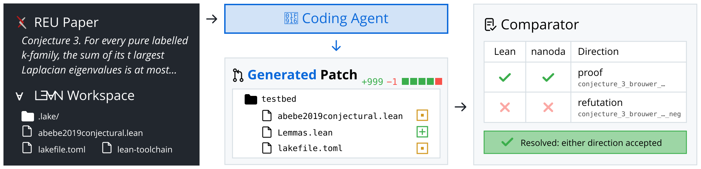

<h1 align="center">ReuF2F</h1>

<div align="center" style="line-height: 1;">
  <a href="docs/index.md"></a>
  <a href="LICENSE"></a>
</div>

<p align="center"><em>Can coding agents prove open conjectures from undergraduate research, formal to formal?</em></p>

This is the anonymous review release. Download and extract the source archive
provided with the submission. Build the evaluation image locally using the
instructions below; this release does not require an author-hosted image.

## Overview

ReuF2F is a benchmark for evaluating coding agents on open mathematical problems from undergraduate research formalized in Lean.
Given a *Lean file* with an open *problem*, a model is tasked with generating a *patch* that either proves the theorem or proves its full negation.



The benchmark has 244 problems. Each one is a conjecture or an expressly open
problem stated in a paper or report from an undergraduate research program.

To access reuF2F, copy and run the following code from the repository root:
```python
import json
reuf2f = [json.loads(line) for line in open("test.jsonl")]
```

## Set Up
ReuF2F uses Docker for reproducible evaluations.
Follow the instructions in the [Docker setup guide](https://docs.docker.com/engine/install/) to install Docker on your machine.
If you're setting up on Linux, we recommend seeing the [post-installation steps](https://docs.docker.com/engine/install/linux-postinstall/) as well.

Install [elan](https://github.com/leanprover/elan) for the pinned Lean toolchain.
Finally, to build reuF2F from source (Python 3.11+), follow these steps:
```bash
# Extract the anonymous source archive, then enter its directory.
cd reuF2F
pip install -e '.[test]'

cd lean && lake exe cache get && lake build && cd ..
reuf2f dataset check .
```

Build the shared evaluation image and test your installation by running:
```bash
reuf2f images build ./docker
pytest -rs tests/test_cli.py::test_one_instance
```
The test evaluates a one-problem dataset whose submitted refutation must be accepted.
It is skipped, not passed, when Docker or the image is unavailable.

> [!NOTE]
> The shared image is `linux/amd64`. On an M-series Mac or another ARM-based system, it runs under emulation.

## Usage
Evaluate patch predictions with the following command:
```bash
reuf2f eval test.jsonl -p <path_to_predictions> --run-id <run_id> -j <num_workers>
```

`DATASET` is a local `.json` or `.jsonl` file built by `reuf2f dataset build`,
such as the `test.jsonl` at the repository root:

```bash
reuf2f eval test.jsonl -p preds.json -i abebe2019conjectural   # one instance
reuf2f report <run_id>                        # re-grade saved logs, no Lean runs
```

Other commands:

```bash
reuf2f dataset build . -o <dir>               # rebuild test.jsonl from lean/
reuf2f images push ./docker                   # upload the shared image
reuf2f --help                                 # all commands
```

This command will generate evaluation logs (`logs/evaluation`) in the current directory.

The run summary is written to `logs/evaluation/<run_id>/results.json`.

> [!NOTE]
> **Result Caching**: The evaluation harness caches results by `run_id`, model name and `instance_id`. If you run the same instance with the same `run_id` multiple times, even with different patches, the harness reuses the saved report and does not re-evaluate. To re-evaluate an instance with a different patch, you must use a different `run_id`.

> [!WARNING]
> ReuF2F evaluation runs untrusted Lean code and can be resource intensive.
> Use a disposable host without credentials or sensitive data.
> The shared image is about 15GB; Docker Desktop may use several times that on disk while pulling and unpacking it, so keep at least 60GB free.
> Each worker runs two Comparator processes at once, so choose `-j` for the CPUs and memory available to Docker.

To see the full list of arguments for the evaluation harness, run:
```bash
reuf2f eval --help
```

See the [evaluation guide](docs/guides/evaluation.md) for the full rundown.

Generate predictions with a solver of your choice in the [prediction format](docs/guides/evaluation.md#prediction-format).

## Downloads
| Dataset | Problem manifest |
| - | - |
| [test.jsonl](test.jsonl) | [lean/metadata.jsonl](lean/metadata.jsonl) |

## Contributions
We would love to hear from the mathematics, formal verification and machine learning communities, and we welcome new problems, corrections to formal statements, pull requests and issues!
To do so, please file a new pull request or issue. Run `(cd lean && lake build)`, `reuf2f dataset check .` and `pytest` before submitting.

## License

MIT license. Check [LICENSE](LICENSE).
